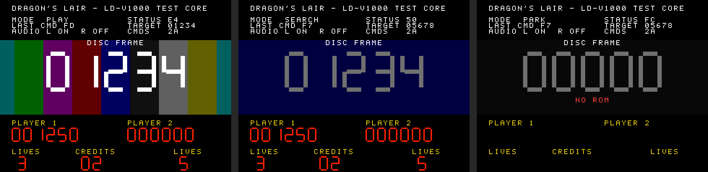

# Dragon's Lair for Analogue Pocket (openFPGA)

An FPGA recreation of the Dragon's Lair (Cinematronics, 1983) arcade board for
the Analogue Pocket, US LD-V1000 revisions.

**Status: milestone 1.** The real game program runs on the emulated board and
talks to an emulated Pioneer LD-V1000 laserdisc player. There is no disc video
yet: the screen shows what the player is doing (mode, status byte, last
command, search target, current disc frame) plus the cabinet's LED
scoreboard. When the game is working you can watch it seek to scenes and play
them by frame number, insert coins, and see the score and lives update.


*Rendered by the video testbench: playing at frame 1234, seeking, and parked with no ROM.*

| Milestone | What | State |
|---|---|---|
| 1 | Z80 board, AY-3-8910, scoreboard, LD-V1000 protocol, test-pattern video, Pocket wiring, CI | this build |
| 2 | Disc video streamed from SD (converted from Hypseus/Daphne `.m2v`), disc audio | next |
| 3 | Seek timing polish, Space Ace / other LD-V1000 games | later |

## What's in the core

```
Z80 (T80s) @ 4 MHz ── 40 KB ROM, 2 KB RAM
   │
   ├─ AY-3-8910 (jt49) @ 2 MHz ── beeps + DIP switch ports A/B
   ├─ 16 x 7-segment scoreboard latches
   └─ LD-V1000 parallel port ──► ldv1000_hle ──► frame number, mode
                                                   │
                                       ld_testvideo (320x240 @ 59.94 Hz)
```

Memory map, IRQ rate and DIP defaults are taken from MAME's `dlair.cpp`. The
laserdisc side follows MAME's `ldv1000hle.cpp`, which runs Rev F2 correctly;
the two places it differs on purpose are marked `DEVIATION` in
`src/fpga/rtl/ldv1000_hle.v`. Details in [docs/ARCHITECTURE.md](docs/ARCHITECTURE.md).

## Building

GitHub Actions does everything (`.github/workflows/build.yml`):

1. **Verilator tests**: protocol test for the LD-V1000 and a render test for
   the video (`make -C sim`).
2. **Quartus build** in the `raetro/quartus:21.1` container. The workflow pulls
   Analogue's [openFPGA core template](https://github.com/open-fpga/core-template)
   at a pinned commit for `apf_top`, the bridge and the project file, then
   overlays `src/fpga/core` and `src/fpga/rtl`.
3. **Package**: bit-reverses the RBF into `bitstream.rbf_r` and uploads a
   ready-to-copy SD card folder as the `openfpga-dragonslair-sd` artifact.

If your Tempest repo uses a different Quartus image or build steps, swap them
in; nothing here depends on 21.1 specifically.

To build locally, copy `src/fpga` from the template, overlay this repo's
`src/fpga/core` and `src/fpga/rtl`, and apply the same three `ap_core.qsf`
edits the workflow makes.

## Installing

1. Copy the artifact's `Cores`, `Platforms` and `Assets` folders to the root
   of the Pocket's SD card.
2. Build the ROM from your MAME `dlair` set (Rev F2) and drop it in
   `/Assets/dragonslair/common/`:
   ```
   python3 tools/make_rom.py dlair.zip -o dlair.rom
   ```
   The script checks every chip's CRC. `-s dlaird` builds Rev D instead.
3. Start "Dragon's Lair" from the Arcade category.

Controls: D-pad = joystick, A or B = sword, Start = start 1, Select = coin 1,
Y = start 2, X = coin 2. DIP switches are in Core Settings.

## Testing on hardware (milestone 1)

What a healthy board looks like:

- Right after boot the disc is **PARK**ed, status `FC`. Within a second or so
  the game should start sending commands: **CMDS** counts up and **LAST CMD**
  changes.
- The attract mode searches (`MODE SEARCH`, status `50`/`D0`, **TARGET** set)
  and then plays (`MODE PLAY`, status `E4`); the big frame number counts up
  and the colour bars scroll.
- Coin with Select: the **CREDITS** digits go up. Start a game and the lives
  and score digits light.

If CMDS stays at 00 the CPU isn't reaching the laserdisc code: check the ROM
(a red NO ROM means the slot didn't load) and the DIP switch bank B bit 3
(LD-V1000 select, held on in the menu).

## Layout

```
src/fpga/core/   Pocket-specific: core_top.v, PLL, I2S, timing constraints
src/fpga/rtl/    platform-neutral core: board, LD-V1000, video, T80, jt49
sim/             Verilator testbenches (+ lint stubs)
tools/           ROM builder, RBF reverser, overlay text/font generator
dist/            Pocket SD card layout (JSON definitions)
docs/            architecture notes and the milestone 2 plan
```

## Credits and licence

- T80 Z80 core: Daniel Wallner, MikeJ, Sorgelig and others (BSD-style, see
  `src/fpga/rtl/t80`), taken from MiSTer-devel/ZX-Spectrum_MISTer.
- jt49 AY-3-8910: Jose Tejada (GPL-3.0), github.com/jotego/jt49.
- Hardware details: MAME `dlair.cpp` (Aaron Giles) and `ldv1000hle.cpp`
  (Ryan Holtz), BSD-3-Clause.
- openFPGA template: Analogue.

This core is GPL-3.0-or-later (because of jt49). No ROMs or disc images are
included; use ones you own.
"# openfpga-dragonslair" 
